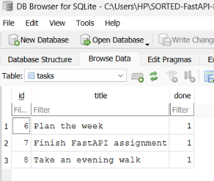
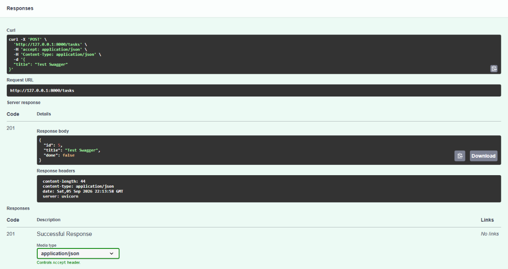
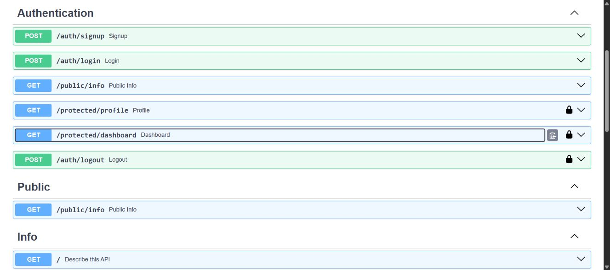
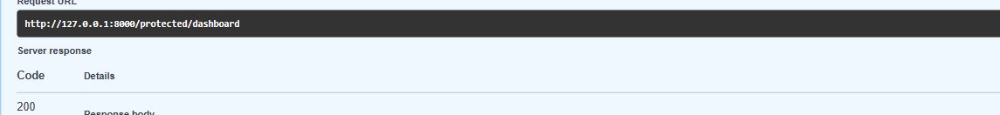

# ✦ SORTED.

> A quiet, considered to-do list, built as a FastAPI CRUD API with a SQLite memory, and a small browser space for the things that matter.

**SORTED.** is a to-do list that keeps its promises. Add a task, tick it off, change your mind, delete it, and it all happens through a clean FastAPI backend where every request gets one clear answer.

Under the hood is a small, tidy Task API with full CRUD: create, read, update, and delete, each mapped to the right HTTP method and status code. On top sits a clean, responsive dashboard, so it's a tool you'd actually want to open, not just a set of endpoints on paper.

It began as a whiteboard: tasks lived in memory and vanished on every restart. Now it's a notebook: tasks are saved in SQLite and are still there tomorrow. Same endpoints, same behavior, just a memory that lasts. ✦

---

## ✦ Highlights

- ✅ **Full CRUD** — create, list, read, update, and delete tasks
- 🐍 **Python + FastAPI** — an approachable backend framework with automatic docs
- 📛 **Correct status codes throughout** — `200`, `201`, `204`, `400`, `401`, `404`, each with a clear JSON error where it applies
- 🛡️ **Server-side validation** — a missing or empty title is rejected before it ever reaches the database
- 📚 **Swagger UI** — interactive docs and a full "Try it out" CRUD cycle at `/docs`
- 🗄️ **SQLite storage** — data survives restarts, kept safe with parameterized `?` queries
- 🔐 **Supabase authentication** — signup, login, and logout, with bearer-protected routes verified by Supabase
- 🎨 **SORTED. dashboard** — a responsive personal task interface at `/app`
- 🧪 **curl-testable** — every endpoint verified from the terminal, not just the browser

---

## 🛠️ Built With

- **Python 3.10+**
- **FastAPI** — API framework, with OpenAPI/Swagger built in
- **SQLite** — a single-file database, built right into Python (`sqlite3`)
- **Supabase Auth** — signup, login, logout, and token verification
- **Uvicorn** — local dev server
- **HTML, CSS, and JavaScript** — the SORTED. dashboard

---

## 🚀 Run It

```bash
git clone https://github.com/FaizaEsha/SORTED-FastAPI-CRUD.git
cd SORTED-FastAPI-CRUD
py -m venv .venv
.\.venv\Scripts\Activate.ps1        # macOS/Linux: source .venv/bin/activate
pip install -r requirements.txt
```

Then start the server — **this is the one command that runs everything**:

```bash
uvicorn main:app --reload
```

| Page | Address |
|---|---|
| API front door | `http://127.0.0.1:8000/` |
| SORTED. dashboard | `http://127.0.0.1:8000/app` |
| Swagger UI | `http://127.0.0.1:8000/docs` |
| Health check | `http://127.0.0.1:8000/health` |

Stop with `Ctrl + C`. Restarting keeps your data, which lives in `tasks.db` — see The Mortality Experiment below.

---

## 🔗 API Endpoints

| Method | Path | What it does | Success | Errors |
|---|---|---|---|---|
| `GET` | `/` | Describes the API | `200` | — |
| `GET` | `/health` | Checks the server is alive | `200` `{"status":"ok"}` | — |
| `GET` | `/tasks` | Returns every task | `200` + list | — |
| `GET` | `/tasks/{id}` | Returns one task | `200` + task | `404` unknown id |
| `POST` | `/tasks` | Creates a task | `201` + created task | `400` missing/empty title |
| `PUT` | `/tasks/{id}` | Updates title and/or done | `200` + updated task | `400` invalid body · `404` unknown id |
| `DELETE` | `/tasks/{id}` | Removes a task | `204 No Content` | `404` unknown id |

Every error returns a plain JSON message, e.g.:
```json
{ "error": "Task 99 not found" }
```

---

## 🗄️ Database (SQLite)

**Why SQLite?** It is a single file with zero setup, needs no separate server, and keeps data after the server restarts. Perfect for a project this size.

**Where is the database?** `tasks.db` in the project folder. It is created automatically on first run (the table plus 3 starter tasks, seeded only once) and it is git-ignored, so every clone starts fresh.

**How is it kept safe?** Every query uses `?` placeholders instead of gluing user text into SQL, so a sneaky title can't turn into a sneaky command.

**Run it:**

```bash
pip install -r requirements.txt
uvicorn main:app --reload
```

**SQL I ran by hand:** `SELECT COUNT(*) FROM tasks;` returned `3`, the number of tasks in the table.



---

## 🧪 Tested with curl

```bash
curl -i http://127.0.0.1:8000/tasks
```

```text
HTTP/1.1 200 OK
content-type: application/json

[
  {"title":"Plan the week","done":false,"id":1},
  {"title":"Finish FastAPI assignment","done":false,"id":2},
  {"title":"Take an evening walk","done":true,"id":3}
]
```

Creating a task (PowerShell — write the body to a temp file first):
```powershell
curl.exe -i -X POST http://127.0.0.1:8000/tasks -H "Content-Type: application/json" --data-binary "@create-task.json"
```
```json
{ "title": "Practice CRUD" }
```

---

## 📚 Swagger UI

FastAPI generates interactive docs automatically at `/docs` — no setup required. Every endpoint is listed, and the full create → read → update → delete cycle works through **Try it out**, no curl needed.



---

## 📁 Project Structure

```text
├── static/
│   ├── index.html       # SORTED. dashboard structure
│   ├── styles.css       # Beige, brown, and black responsive styling
│   └── app.js           # Frontend requests to the FastAPI CRUD endpoints
├── docs/                # Screenshots (Swagger UI, DB Browser, auth) and AUTH_SETUP.md
├── tests/
│   └── test_api.py      # 31 automated regression tests (CRUD, dashboard, and auth)
├── .github/workflows/
│   └── tests.yml        # Runs the test suite on every push and pull request
├── main.py              # Models, database setup, routes, validation, error handling
├── auth.py              # Supabase signup, login, logout, and protected routes
├── tasks.db             # created automatically, git-ignored
├── .env.example         # Supabase placeholders only; copy to .env (git-ignored)
├── requirements.txt     # FastAPI, Uvicorn, Supabase, and python-dotenv
├── requirements-dev.txt # Adds pytest and httpx for testing
├── .gitignore
└── README.md
```

---

## 🔐 Supabase Authentication

Signup, login, caller-specific logout, verified profile and dashboard routes, and Swagger bearer authorization are now included. [Read the step-by-step setup, endpoint table and verification guide](docs/AUTH_SETUP.md).

The task dashboard keeps its original design and SQLite storage. Task routes remain public and shared; user-specific task isolation is not part of this assignment.

Copy `.env.example` to `.env`, set `SUPABASE_URL` and `SUPABASE_KEY` to your project's URL and public anon/publishable key, then install `requirements.txt`. Never use a secret/service_role key. Start everything with `uvicorn main:app --reload`. Confirm the signup email before logging in if email confirmation is enabled.

| Method | Endpoint | Bearer token required | Success |
|---|---|---|---|
| POST | `/auth/signup` | No | 201 |
| POST | `/auth/login` | No | 200 + access/refresh tokens |
| POST | `/auth/logout` | Yes | 204 |
| GET | `/protected/profile` | Yes | 200 + safe user metadata |
| GET | `/protected/dashboard` | Yes | 200 |
| GET | `/public/info` | No | 200 |

Missing credentials return 400; missing, malformed or invalid tokens return 401. The protected routes share a dependency that verifies tokens with Supabase `get_user(token)`. Passwords are managed by Supabase. `.env` is ignored; the committed example contains placeholders only.

**Verified on October 30, 2026:** real signup returned 201; confirmed-account login, profile and dashboard returned 200; missing/tampered tokens and a wrong password returned 401; logout returned an empty 204. The curl checks and authorized Swagger profile/dashboard calls passed. All 31 automated regression tests also passed.

Swagger shows locked protected routes:



Real authorized dashboard HTTP 200 result (cropped to exclude tokens and account metadata):



---

## 🕯️ The Mortality Experiment

Round one: tasks lived in the server's memory, so every restart wiped them and the three seed tasks came back. Round two, with SQLite: I created a few tasks, stopped the server, and started it again. This time they were all still there, because they live in `tasks.db` on disk, not in the server's head. The list finally outlives the server. That was the whole point of adding a database.

---

## 🎯 What I Learned

- Mapping CRUD to `POST`, `GET`, `PUT`, and `DELETE`, and choosing the right status code for each outcome
- Writing server-side validation instead of trusting the client
- Using Swagger UI to both document and test an API
- Moving storage from memory to SQLite without changing a single endpoint's behavior
- Using parameterized `?` queries, and seeding data only once so restarts never create duplicates
- Reading and editing real rows by hand with SQL in DB Browser
- Wiring a small frontend to a backend API with `fetch`
- Letting Supabase Auth handle signup, login, and passwords instead of storing credentials myself
- Protecting routes with one shared FastAPI dependency that verifies every bearer token with Supabase
- Telling `400` (missing credentials) apart from `401` (missing, malformed, or invalid token)
- Keeping secrets out of Git: a git-ignored `.env`, a placeholder-only `.env.example`, and never a `service_role` key
- Using Swagger's **Authorize** button to test locked routes, and proving the flow with curl and automated regression tests

---

## Note

Built to run locally as part of FlyRank's Backend AI Engineering Track. Storage is a single SQLite file on purpose. The original task dashboard and public CRUD behavior are preserved. FlyRank A4 adds Supabase authentication separately; see the setup guide above.

## Author

**Faiza Ahmed Esha**

## License

You're welcome to clone this, run it locally, and test it end to end, that's the best way to see how the CRUD cycle actually behaves. Please don't submit this code, or a lightly edited copy of it, as your own coursework; use it to learn from, not to hand in.
